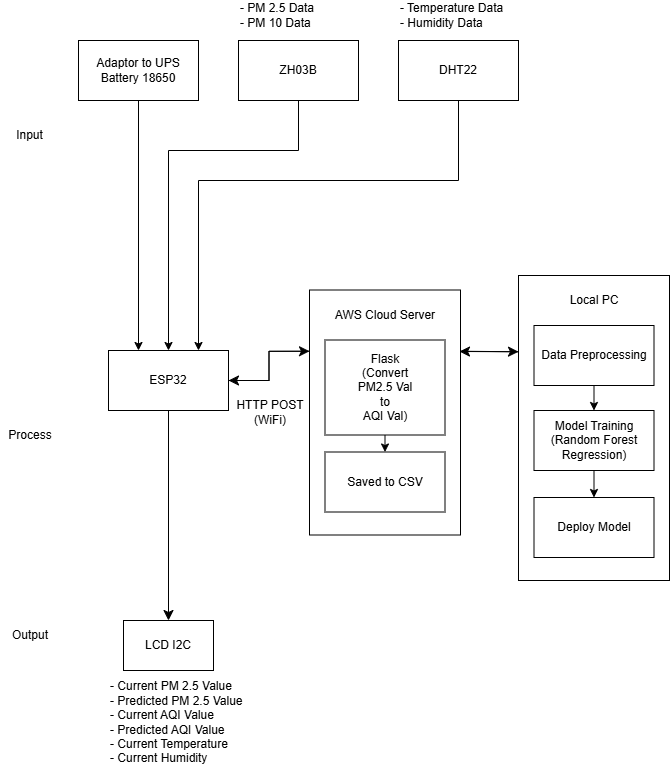
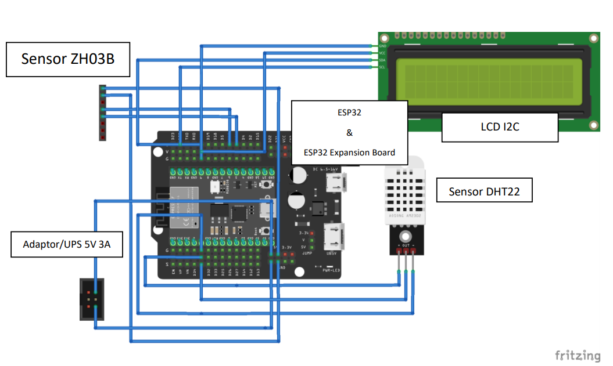
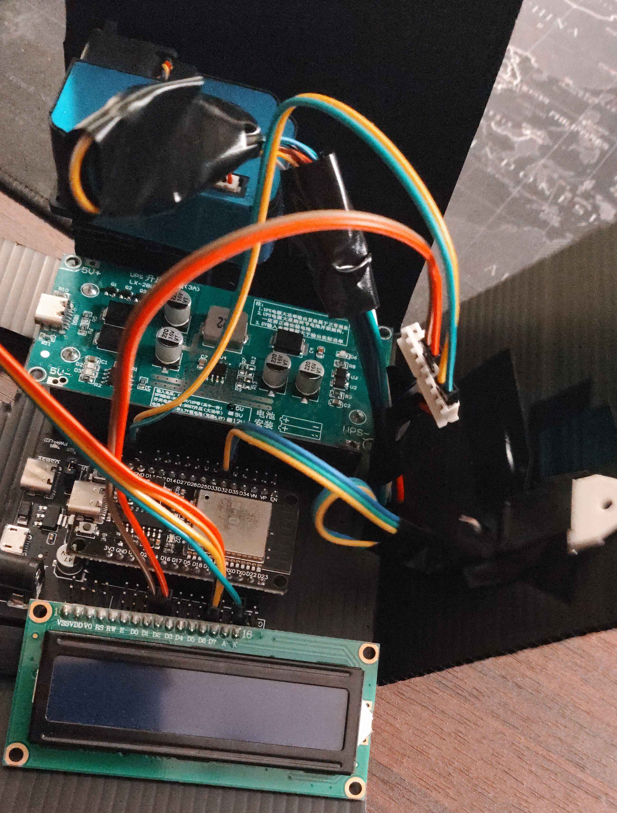
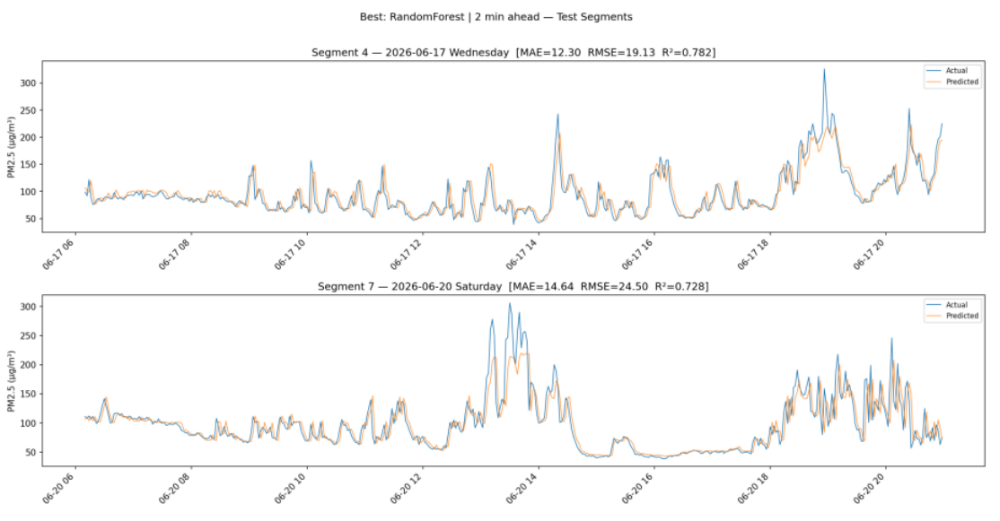

# Air Quality Monitoring & Prediction System

An end-to-end IoT-based air quality monitoring and forecasting system. The system collects real-time particulate matter (PM2.5, PM10) and ambient climate data (temperature, humidity) using an ESP32 microcontroller with ZH03B and DHT22 sensors, transmits readings to a Flask REST API backend, computes the US EPA Air Quality Index (AQI), and predicts future PM2.5 concentrations 2 minutes ahead using a trained Random Forest Regressor model.

---

## Features

- **Real-Time Environmental Sensing** — Reads PM2.5, PM10 via UART from a Winsen ZH03B laser dust sensor and ambient temperature/humidity via DHT22 every 2 minutes.
- **On-Device Status Display** — 16x2 I2C LCD rotating every 5 seconds across three informational screens:
  - Screen 1: Current vs. Predicted PM2.5 concentration (µg/m³)
  - Screen 2: Current vs. Predicted US AQI value
  - Screen 3: AQI Category status and Temperature / Humidity
- **Automated CSV Logging** — Logs incoming sensor metrics on the server with timestamps for record-keeping and dataset expansion.
- **US EPA AQI Calculation** — Computes AQI from PM2.5 concentration using official EPA linear interpolation breakpoints (40 CFR Part 58 Appendix G).
- **Short-Term PM2.5 Forecasting** — Predicts PM2.5 levels 1 step (2 minutes) ahead using a multi-feature Random Forest model with a 3-timestep rolling buffer, lag features, and temporal signals (decimal hour, weekday indicator).
- **AQI Health Advisories** — Returns human-readable health guidance corresponding to current and predicted AQI categories (Good, Moderate, Unhealthy for Sensitive Groups, Unhealthy, Very Unhealthy, Hazardous).
- **Secure Configuration Management** — Decoupled network and hardware credentials using `.env` on the backend and `secrets.h` on the ESP32.

---

## Tech Stack

### Backend & Machine Learning

- **Backend Framework:** Python 3.x, Flask
- **Machine Learning:** scikit-learn (Random Forest Regressor), joblib
- **Data Analysis & Processing:** pandas, numpy, matplotlib
- **Environment & Configuration:** python-dotenv

---

### Hardware & Embedded

- **Microcontroller:** ESP32 Dev Module
- **Sensors:** Winsen ZH03B Laser Particle Sensor (PM1.0 / PM2.5 / PM10), DHT22 (Temperature & Humidity)
- **Display:** 16x2 I2C Character LCD (PC8574 / 0x27)
- **Firmware Framework:** C++ / Arduino for ESP32 (`WiFi`, `HTTPClient`, `HardwareSerial`, `ArduinoJson`, `LCD_I2C`, `DHT`, `BlynkTimer`)

---

### Diagram



### Design Scheme



### Design Implementation



### Predict Result



---

## Project Structure

```
├── data/                                      # Collected sensor datasets (CSV)
│   ├── dataset_polusi_*.csv
│   └── ...
├── esp32/                                     # ESP32 firmware & configurations
│   └── esp32_air_quality/
│       ├── esp32_air_quality.ino              # Main Arduino sketch
│       └── secrets.h.example                  # Template for WiFi & server credentials
├── model/                                     # Machine learning models & notebooks
│   ├── best_model.pkl                         # Trained Random Forest model (joblib)
│   └── rf_model_air_quality_predict_final.ipynb # Model training & evaluation notebook
├── src/                                       # Flask backend source code
│   └── app.py                                 # Production Flask application
├── .gitignore
└── README.md
```

---

## API Endpoints

| Method | Endpoint        | Description                                  |
| ------ | --------------- | -------------------------------------------- |
| GET    | `/`             | Server status, loaded model type, and buffer |
| POST   | `/kirim-data`   | Ingest sensor data from ESP32 & get forecast |
| GET    | `/buffer`       | Inspect the current rolling sliding buffer   |
| POST   | `/reset-buffer` | Clear the rolling sliding buffer             |

### Example Ingestion Request

```bash
curl -X POST http://<server-ip>:5000/kirim-data \
  -H "Content-Type: application/json" \
  -d '{"pm25": 35.2, "pm10": 42.0, "temp": 30.5, "hum": 75.0}'
```

### Example Ingestion Response

```json
{
  "status": "success",
  "time": "07/29/26 08:52:19",
  "buffer_status": "3/3",
  "current": {
    "pm25_ugm3": 35.2,
    "aqi": {
      "aqi_value": 100,
      "category": "Moderate",
      "category_short": "Moderate",
      "health_message": "Acceptable; sensitive people may be affected."
    }
  },
  "prediction": {
    "horizon_minutes": 2,
    "pm25_ugm3": 37.15,
    "aqi": {
      "aqi_value": 105,
      "category": "Unhealthy for Sensitive Groups",
      "category_short": "Sensitive Grp",
      "health_message": "Sensitive groups should reduce outdoor activity."
    },
    "note": "PM2.5 & AQI predicted 2 min ahead"
  }
}
```

## Project Background

This project was developed as part of an undergraduate thesis (_skripsi_). It integrates Internet of Things (IoT) edge computing with machine learning to monitor ambient air pollution and forecast short-term PM2.5 levels, providing actionable, real-time AQI health alerts.

---

_Built as an undergraduate thesis project._
